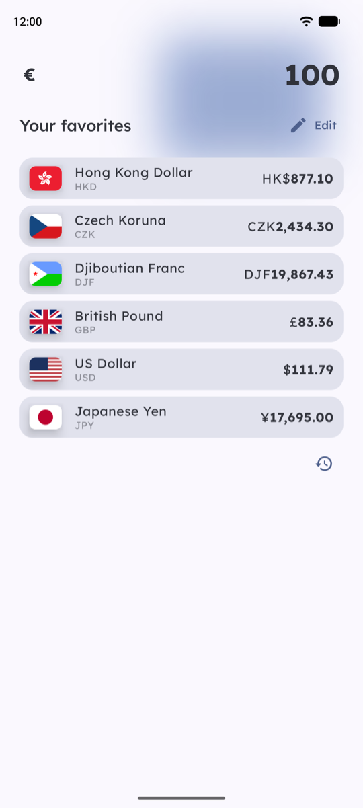
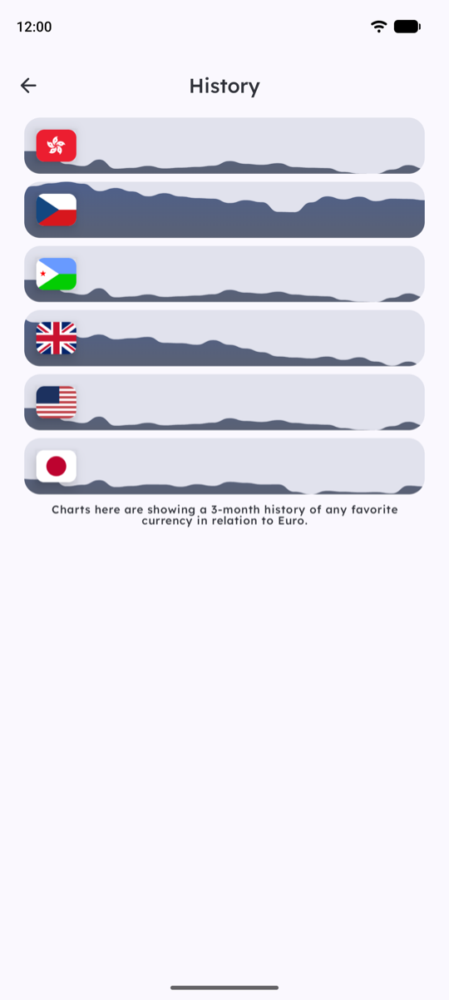
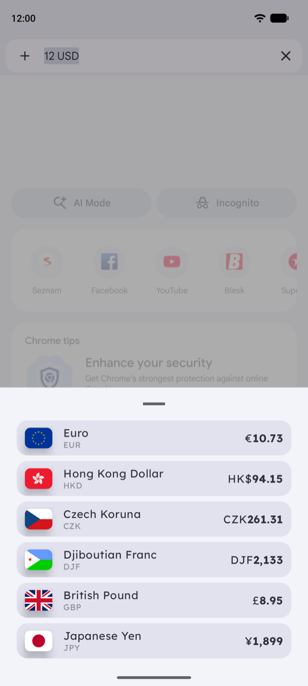
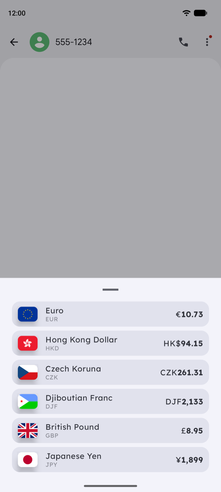
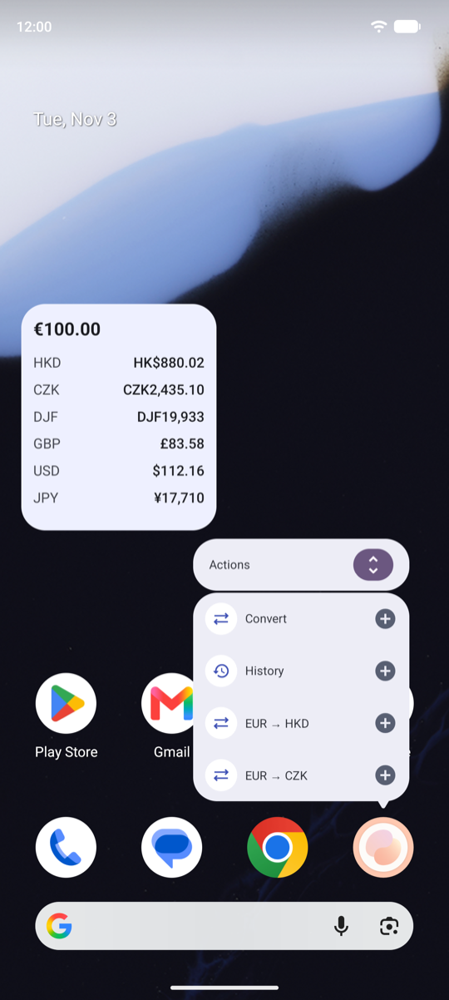
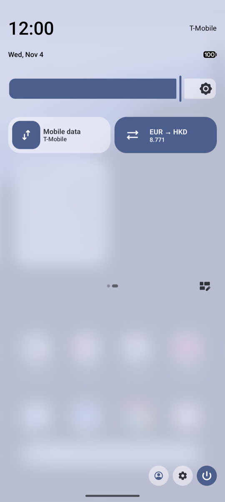
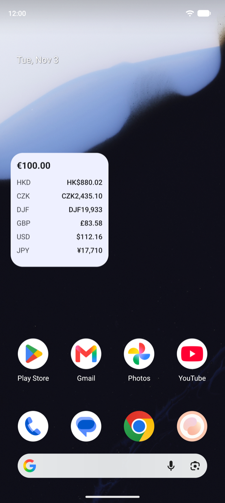

# Currency

Android currency conversion.

* Currency rates from
  the [European Central Bank](https://www.ecb.europa.eu/stats/policy_and_exchange_rates/euro_reference_exchange_rates/html/index.en.html)
* 32 international currencies + all available pegs
* Currency rates updated every workday
 * All rates downloaded prior to being offline retained for use offline

## Screenshots

<table>
  <tr>
    <td align="center"> Converter with favorite currencies</td>
    <td align="center"> 3-month history of favorites against EUR</td>
  </tr>
  <tr>
    <td align="center"> "Show exchange rate" on selected text in Chrome</td>
    <td align="center"> Cursola in the system share sheet</td>
  </tr>
  <tr>
    <td align="center"> Conversions for text shared from Messages</td>
    <td align="center"> Launcher shortcuts</td>
  </tr>
  <tr>
    <td align="center"> Quick Settings "Exchange rate" tile</td>
    <td align="center"> Favorites widget on the home screen</td>
  </tr>
</table>

## System integrations

* **Text selection** – "Show exchange rate" in the selection menu of apps that show third-party text
  actions, such as Chrome
* **Share** – share any text to Cursola ("Show exchange rate"); works in every app with a share
  action, including Messages
* **Launcher shortcuts** – Convert, History and shortcuts for favorite pairs
* **Quick Settings tile** – "Exchange rate" shows a current rate, refreshed when the panel opens
* **Home-screen widget** – favorite currencies converted from your current amount
* **Rates ContentProvider** – other apps can query rates through authority
  `wiki.depasquale.cursola.rates` with the permission `wiki.depasquale.cursola.permission.READ_RATES`;
  the `/convert` path requires a `to` parameter
* **AppFunctions** – on Android 16+ the app exposes `convert`, `convertToFavorites`, `latestRates`
  and `listCurrencies` to system agents; whether Gemini calls them depends on Google's rollout
